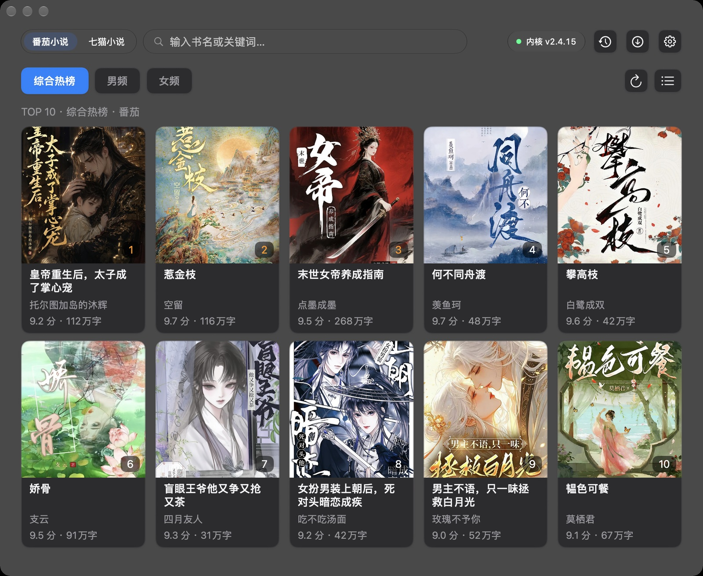
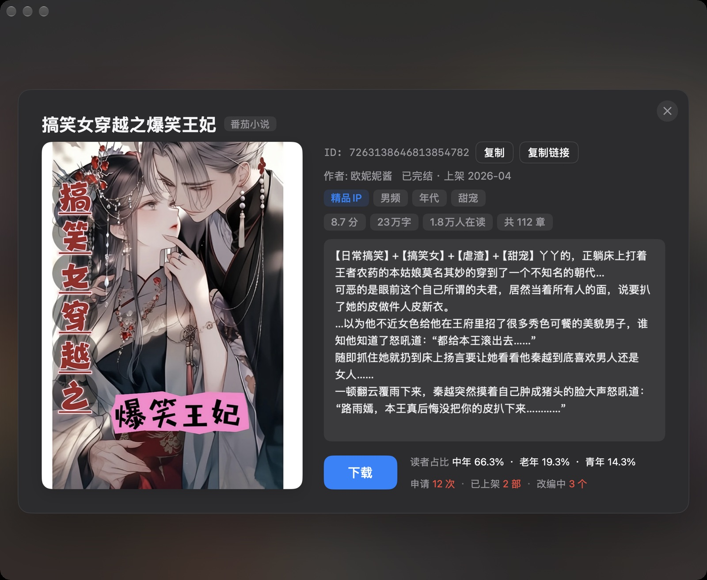

# 番茄猫 · 番茄小说 / 七猫小说 桌面下载器（macOS 原生版）

> ## ⬇️ 下载最新版
>
> ### [**点这里下载 → GitHub Releases**](https://github.com/YUKI0104/novel-downloader/releases/latest)
>
> 直连安装包（.dmg，打开后把「番茄猫」拖进「应用程序」）：
> **https://github.com/YUKI0104/novel-downloader/releases/latest/download/FanQieMao-2.5.0-universal-macOS14.dmg**

一个 macOS 原生（Swift 6 + SwiftUI）的**番茄小说 / 七猫小说**下载与看榜工具：搜书 / 看榜 → 进详情 → 一键整本导出 **TXT**。
另外带一个**短剧 IP 命中**功能：在番茄的搜索与榜单里直接标出「这本书在短剧后台的申请/上架情况」，详情页直接显示短剧后台数据（默认关闭）。

---

## 界面预览

**① 榜单页** —— `综合热榜 / 男频 / 女频` 三个榜单，右上角一键刷新；卡片右下角是名次，顶栏搜索框支持书名 / 纯数字 ID / 网页链接三种入口。



**② 详情页** —— 封面、评分、字数、在读人数、章节数、简介、标签一屏看完。右下角「下载」按钮本身就是状态机：下载中在按钮内从左到右填充进度，下载完成后变成「访达」按钮（点一下直接在访达里定位到文件），文件删掉后自动变回「下载」。
图里「下载」按钮右侧那两行（读者占比 / 申请·已上架·改编中）来自**短剧后台**，只有开启短剧功能才会显示；没开就是一本干净的番茄书。



---

## 系统要求 —— 请先看这张表（**尤其 Intel 机器**）

| 项目 | 要求 |
|---|---|
| 芯片 | **Apple Silicon（M1/M2/M3/M4…）与 Intel（x86_64）都支持** —— 安装包是 **Universal 2 通用二进制**，同一份包两代机器都能装 |
| 最低系统 | **macOS 14.0（Sonoma）或更新** |
| **Intel 机器** | **必须 macOS 14 或更新**。**macOS 13（Ventura）、12（Monterey）、11（Big Sur）及更早的 Intel 机器打不开这个包**（会弹出「需要 macOS 14」）。工程按 14/15/26 分支写，macOS 14 是硬下限，老系统不在支持范围 |
| 磁盘 | 约 100 MB（包含 arm64 与 amd64 两套内核） |

> 一句话：**只要你的 Mac 能升到 macOS 14（Sonoma）**，Intel 或 M 系列都能装能用。

查看自己系统版本：左上角  →「关于本机」。

## 功能

- **搜书**：番茄小说 / 七猫小说，支持书名、纯数字 ID、`fanqienovel.com/page/<id>` 链接三种入口
- **榜单**：番茄榜单（综合热榜 / 男频 / 女频），带一键刷新
- **详情**：封面 / 作者 / 评分 / 字数 / 在读人数 / 章节数 / 简介 / 标签，ID 与链接一键复制
- **下载**：整本导出 **TXT**（番茄走官方 Rust 内核，七猫原生抓取）。下载按钮本身就是状态机：下载中在按钮内从左到右填充进度 → 完成后按钮变成**访达按钮**（点一下在访达里定位到下载好的文件）；文件删掉后自动回到「下载」
- **短剧 IP 命中**（默认关闭，设置里开启）：按**小说 ID** 精确匹配短剧后台，命中的书在卡片上打角标（`上架N部·申请N次`），详情页显示后台的「已完结/上架月份 · 读者占比 · 申请/已上架/改编中 · 标签」
- **最近查看**：搜索过的关键词与看过的书留档，一键清空

## 安装（首次打开会被拦一次，正常）

安装包是**本机自签名**（未经 Apple 公证），第一次打开会被 Gatekeeper 拦下：

1. 打开 .dmg，把「番茄猫」拖进「应用程序」；
2. 到「应用程序」里 **右键点「番茄猫」→ 打开 → 再点「打开」**（只需做一次）；
3. 如果还是被拦，终端执行一次：`xattr -dr com.apple.quarantine /Applications/番茄猫.app`

**短剧 IP 功能**（可选）需要读 Safari 的登录态，要额外授予**完全磁盘访问权限**；设置页里有图文教程引导。功能默认关闭，不用就不用开。

## 数据与隐私

- 小说文件、封面、设置全部**留在本机**（下载目录默认 `~/Downloads`），不上传任何数据；
- 短剧功能只在你**自己已登录 Safari** 的前提下，用你的会话去取你本来就能在网页上看到的数据；密钥只从系统钥匙串读取，不落盘、不外发。

## 声明

仅供**个人学习与本地备份**使用。请支持正版，勿用于任何商业用途或二次分发。

---

# 开发

## 构建与运行

```bash
bash Tools/跑.sh              # 构建 + 启动（Debug）
bash Tools/打包.sh            # Release 构建 + 自签名 + 装到 /Applications（原地覆盖）
bash Tools/发行.sh            # 打 DMG + ZIP（发 Release 用）
bash Tools/selftest.sh chain  # 端到端自检：搜索 → ID/链接直达 → 详情 → 下载
```

工程：`FanQieMao.xcodeproj`（由 `project.yml` 经 XcodeGen 生成，**已随仓库提交**，构建不需要 xcodegen）。
bundle id `com.yuki.fanqiemao`，显示名「番茄猫」，版本 `2.5.0`，最低系统 **macOS 14.0**。

**出通用二进制（Intel + Apple Silicon）必须给 destination**：

```bash
xcodebuild -scheme FanQieMao -configuration Release -destination generic/platform=macOS build
```

只设 `ARCHS="arm64 x86_64"` 而**不给** `-destination`，xcodebuild 会自作主张挑「我的 Mac」(arm64)，产物只有 arm64 —— 这是踩过的坑，两个脚本里都已固定。

## 架构

```
Sources/
  FanQieMaoApp.swift          App 入口（@NSApplicationDelegateAdaptor(AppLifecycle.self)）
  AppModel.swift              ViewModel：搜索/详情/下载/库/设置编排
  LiquidGlassCompat.swift     Liquid Glass 兼容层（唯一出现 #available 的地方）
  Core/Kernel/                内核放置/启动/健康探测/自动更新/退出清理（posix_spawn 独立进程组）
  Core/Fanqie/                番茄搜索/详情/下载流水线
  Core/Qimao/                 七猫搜索/详情/下载
  Core/Shortdrama/            短剧后台（Safari 登录态读取 → 按小说 ID 命中）
  Core/Store/                 SettingsStore / LibraryStore（唯一写盘入口）
  Features/                   Root / Search / Detail / Downloads / History / Shortdrama / Settings
Resources/Kernel/             出厂内核（官方原样文件，arm64 + amd64 各一份）
Tools/                        构建/打包/发行/自检脚本
docs/                         规格与任务书（docs/spec-v0.1.md、docs/tasks/M*.md）
```

- 番茄数据来自官方 Rust 内核 `Tomato-Novel-Downloader v2.4.15`（本地 `127.0.0.1:18423` REST 服务）；
  App 只负责内核的**放置 / 启动 / 健康探测 / 自动更新 / 退出清理**，内核文件原样随包分发（未 lipo、未改字节）
- 内核自动更新：`releases/latest` → 版本比较 → 按架构选 asset → 下载校验 → 原子切换 → 健康检查失败自动回滚；
  直连失败依次走 `ghfast.top` / `gh-proxy.com` / `ghproxy.net` 镜像

## 代码签名（自签名证书，TCC 授权不掉）

默认 `xcodebuild` 是 ad-hoc 签名，designated requirement 绑到 **cdhash**，重编一次就变 →
「完全磁盘访问权限」等 TCC 授权随之失效。仓库改用**本机自签名证书**：

```bash
bash Tools/dev-sign-setup.sh   # 一次性：在 Tools/ 下的独立钥匙串建证书（CN=FanQieMao Dev）
codesign -d -r- /Applications/番茄猫.app   # 验证：应为 identifier "com.yuki.fanqiemao" and certificate leaf = H"…"
```

自签名材料（`Tools/fqmdev.keychain-db` / `*.pem` / `*.p12`）已 gitignore，**不提交**，不进系统信任（TCC 匹配 requirement 即可）。

## 自检钩子（只在设环境变量时启用）

| 环境变量 | 作用 |
|---|---|
| `FQM_SELFTEST=close\|quit\|chain\|update\|m11\|m12` | 点红叉 / Cmd+Q / 端到端链路 / 更新检查 / 界面取证 |
| `FQM_SELFTEST_DELAY` | 延迟秒数（默认 8） |
| `FQM_SELFTEST_KEYWORD` / `FQM_SELFTEST_DOWNLOAD_KEYWORD` | chain 模式的搜索词 / 下载目标 |
| `FQM_DOWNLOAD_LIMIT=3` | 只下前 N 章（验收用） |
| `FQM_MOCK_RELEASE_TAG` + `FQM_MOCK_ASSET_PATH` / `FQM_MOCK_ASSET_URL` | 伪造远端版本跑更新链 |

## 许可

未声明开源许可（保留所有权利）。如需合作或授权请联系作者。
